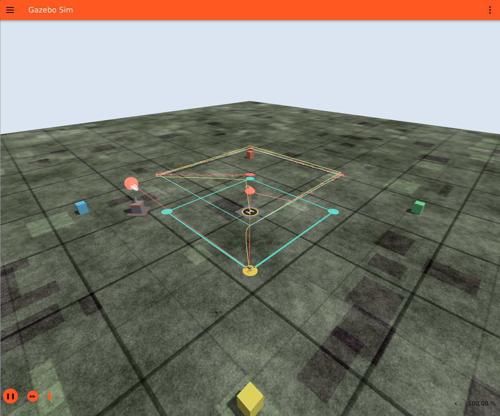
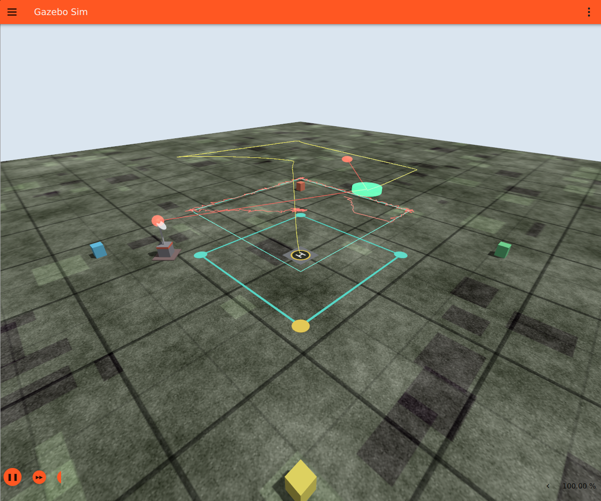
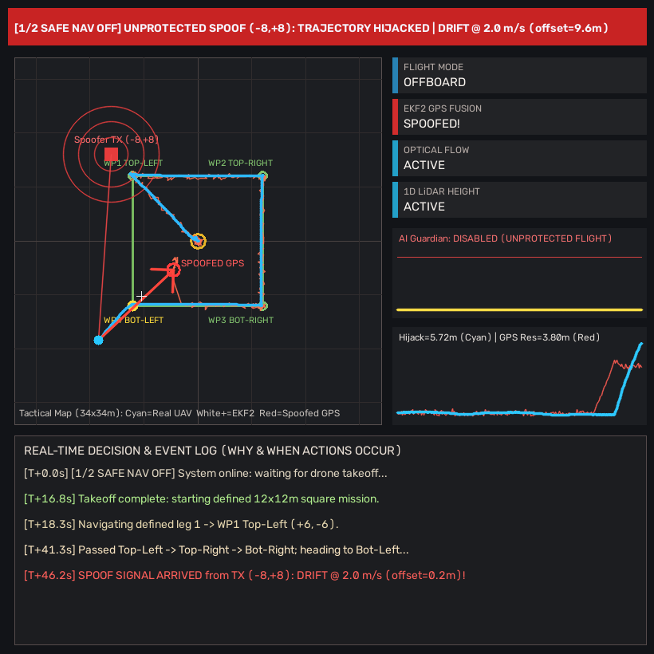
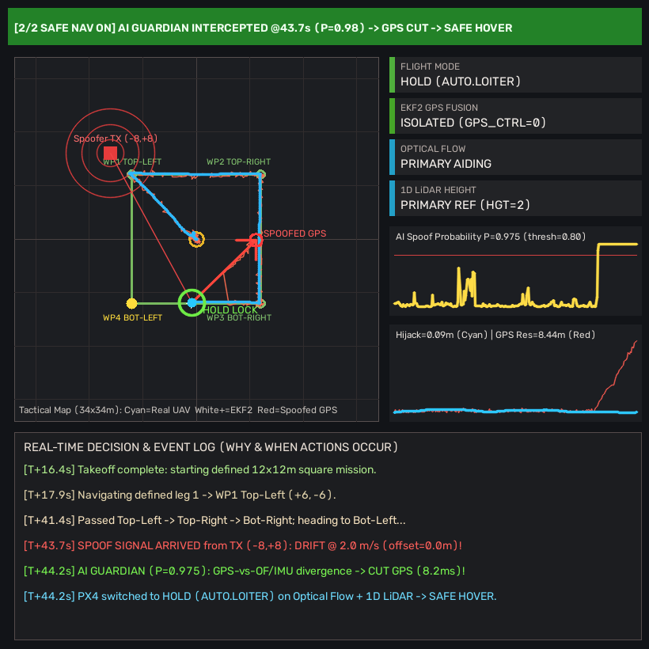
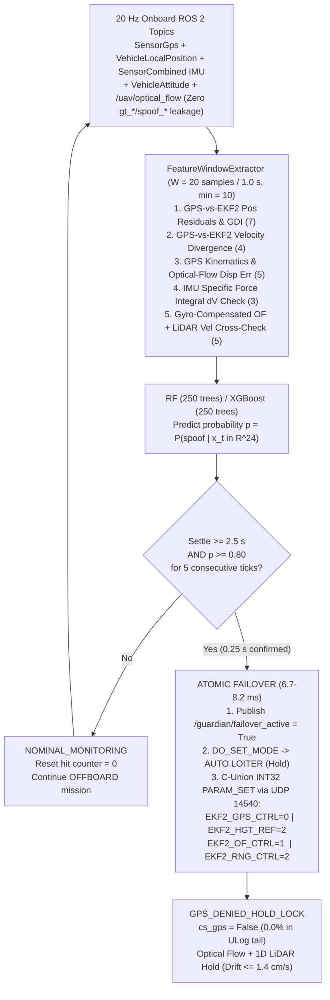
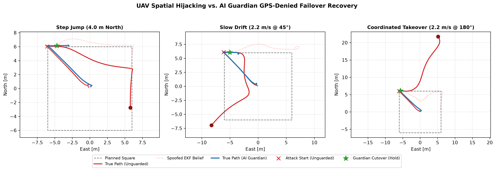
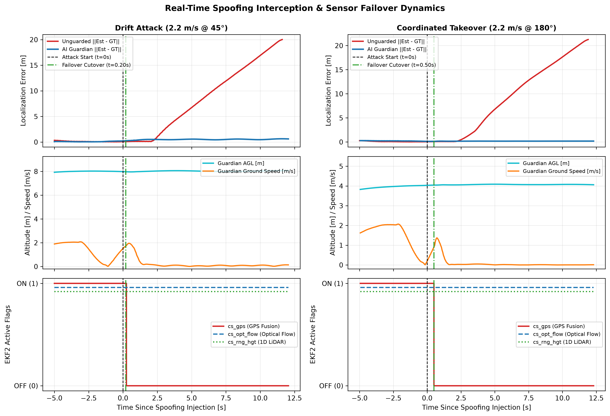
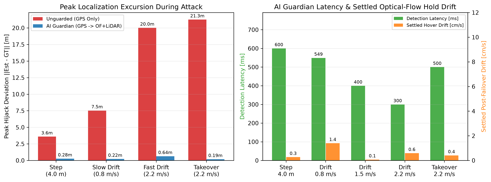
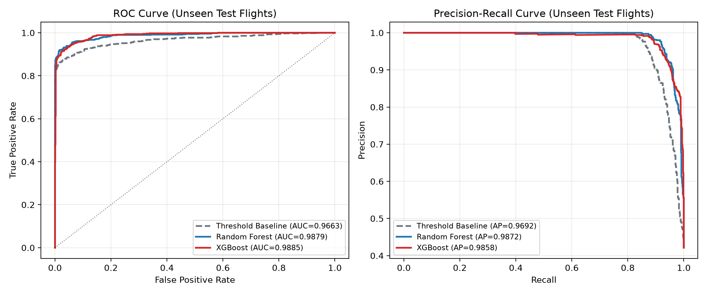

# UAV GPS-Failsafe: AI Spoofing Detection & GPS-Denied Recovery

A reproducible cyber-physical **PX4 Autopilot v1.15.4 SITL + Gazebo Harmonic + ROS 2 Jazzy + Machine Learning** testbed for defending multirotor UAVs against GPS spoofing attacks (**Step Jumps**, **Slow Drift / Meaconing**, and **Coordinated S-Curve Takeovers**).  

When spoofing is detected across onboard telemetry (`24` causal cross-sensor features at `20 Hz`), **AI Guardian** (`guardian_ai_node`) isolates corrupted GNSS over MAVLink (`EKF2_GPS_CTRL = 0`) in **6.7–8.2 ms**, promotes downward **Optical Flow + 1D LiDAR** (`EKF2_HGT_REF = 2`), and commands **safe hover (`AUTO.LOITER`)**, slashing peak hijack excursion from **21.26 m down to 0.19 m** with **zero nominal false triggers**.

---

## Table of Contents

- [Live Demonstration: Safe Navigation OFF vs. ON](#live-demonstration-safe-navigation-off-vs-on)
- [System Architecture (High-Level & Low-Level Design)](#system-architecture-high-level--low-level-design)
- [AI Pipeline, Datasets & Benchmark Results](#ai-pipeline-datasets--benchmark-results)
- [Prerequisites & Installation](#prerequisites--installation)
- [Running the Simulation & Workflows](#running-the-simulation--workflows)
- [Project Website (Local & Netlify Hosting)](#project-website-local--netlify-hosting)
- [Repository Structure](#repository-structure)

---

## Live Demonstration: Safe Navigation OFF vs. ON

The sequential demo launcher (`./scripts/run_demo.sh`) runs an identical autonomous `12 × 12 m` square mission (`WP1 Top-Left` → `WP2 Top-Right` → `WP3 Bottom-Right` → `WP4 Bottom-Left`) and injects a `2.0 m/s @ 45°` drift spoof from `spoofer_tx_station (-8, +8)` mid-way toward **Bottom-Left**:

- **Stage 1/2 — Safe Navigation OFF (Unprotected):** PX4 EKF2 fuses the falsified GPS (red arrow pulling North-East), tricking the closed-loop controller into steering South-West off the flight corridor out to `(-13.1, -13.0)` (**10.73 m** hijack error).
- **Stage 2/2 — Safe Navigation ON (AI Guardian):** At **T+44.2 s**, AI Guardian detects the cross-sensor anomaly (`P = 0.975`), cuts GPS in **8.2 ms**, and locks Optical Flow + 1D LiDAR hover (`HijackErr = 0.09 m` while `GPS Res` diverges past `8.44 m`).

<table>
  <thead>
    <tr>
      <th width="50%">Stage 1/2 — Safe Navigation OFF (Trajectory Hijacked)</th>
      <th width="50%">Stage 2/2 — Safe Navigation ON (AI Guardian Hover Lock)</th>
    </tr>
  </thead>
  <tbody>
    <tr>
      <td align="center">
        
        <br/><sub><b>Gazebo 3D (Safe Nav OFF):</b> Real gold UAV trajectory diverges South-West off Leg 4 under RF attack from <code>spoofer_tx_station</code>.</sub>
      </td>
      <td align="center">
        
        <br/><sub><b>Gazebo 3D (Safe Nav ON):</b> Quadrotor holds inside emerald Guardian shield while spoofed red GPS sphere diverges North-East.</sub>
      </td>
    </tr>
    <tr>
      <td align="center">
        
        <br/><sub><b>Tactical HUD (Safe Nav OFF):</b> Unprotected <code>OFFBOARD</code> flight pulled off corridor (<code>Hijack = 5.72 m</code> at snapshot, reaching <code>10.73 m</code>).</sub>
      </td>
      <td align="center">
        
        <br/><sub><b>Tactical HUD (Safe Nav ON):</b> AI Guardian intercepts spoof (<code>P = 0.975</code>), isolates GPS, switches to <code>HOLD (AUTO.LOITER)</code>, and holds <code>0.09 m</code> error.</sub>
      </td>
    </tr>
  </tbody>
</table>

---

## System Architecture (High-Level & Low-Level Design)

### High-Level Design (HLD)

```mermaid
flowchart LR
  subgraph GZ["1. Gazebo Harmonic Twin (gz-sim8)"]
    X500["x500_flow_lidar SDF<br/>Cam 128x128 @ 30 Hz<br/>1D LiDAR 0.05-60 m @ 30 Hz"]
    WORLD["textured_field.sdf<br/>12x12 m Corridor<br/>spoofer_tx_station (-8, +8)"]
    GZB["ros_gz_bridge<br/>/gz/downward_camera, lidar,<br/>navsat, ground_truth/odom"]
  end

  subgraph ROS_SENSE["2. Sensor & Threat Layer (ROS 2)"]
    BRIDGE["sensor_bridge_node<br/>OpenCV Lucas-Kanade Optical Flow<br/>Nominal HIL_GPS (10 Hz)"]
    ADV["adversary_spoofer_node<br/>Preempts via /adversary/active<br/>Step / Drift / Takeover Spoofing"]
  end

  subgraph PX4["3. PX4 SITL v1.15.4 Core"]
    EKF["PX4 EKF2 Estimator<br/>Fuses GPS + OF + LiDAR + IMU<br/>Runtime Param Cutover + .ulg"]
    UX["Micro XRCE-DDS v2.4.3<br/>/fmu/out/* & /fmu/in/*"]
  end

  subgraph AI_CTRL["4. AI Guardian & Autonomy Layer"]
    GUARD["guardian_ai_node (20 Hz)<br/>24 Causal Features + RF/XGBoost<br/>MAVLink PARAM_SET Override"]
    MIS["mission_runner_node<br/>Offboard NED Square Mission<br/>Yields on /guardian/failover_active"]
    HUD["demo_hud_node &amp; telemetry_logger_node<br/>3D /marker_array + 820x820 HUD + 20 Hz CSV"]
  end

  X500 --> GZB
  WORLD --> GZB
  GZB --> BRIDGE
  BRIDGE -->|"/adversary/active preemption"| ADV
  BRIDGE -->|"MAVLink UDP 14030 (Nominal HIL_GPS, OF, LiDAR)"| EKF
  ADV -->|"MAVLink UDP 13030 (Spoofed HIL_GPS)"| EKF
  EKF <--> UX
  UX --> GUARD
  UX --> MIS
  UX --> HUD
  GUARD -->|"MAVLink UDP 14540 (EKF2_GPS_CTRL=0) + AUTO.LOITER"| EKF
  GUARD -->|"/guardian/failover_active = True"| MIS
```



### Low-Level Design (LLD) — 20 Hz Detection & Failover State Machine



### Hardware Digital Twin & EKF2 Switching Parameters

| Component / Parameter | Configuration / Behavior | Source |
| :--- | :--- | :--- |
| **Airframe (`4015`)** | `SENS_EN_GPSSIM=0`, `MAV_USEHILGPS=1`, EKF2 multi-sensor fusion (`GPS=7`, `OF=1`, `RNG=2`) | [4015_gz_x500_flow_lidar](simulation/airframes/4015_gz_x500_flow_lidar) |
| **Downward Optical Flow Camera** | `128×128` RGB, `0.80 rad` HFOV, `30 Hz`, OpenCV Lucas-Kanade (`winSize=(15,15)`, `maxLevel=2`) → `OPTICAL_FLOW_RAD` | [x500_flow_lidar/model.sdf](simulation/models/x500_flow_lidar/model.sdf), [sensor_bridge_node.py](ros2_ws/src/gps_failsafe_pkg/gps_failsafe_pkg/sensor_bridge_node.py) |
| **Downward 1D LiDAR** | `1×1` `gpu_lidar`, `0.05–60.0 m`, `0.01 m` resolution, `σ=0.01 m` noise @ `30 Hz` → `DISTANCE_SENSOR` | [x500_flow_lidar/model.sdf](simulation/models/x500_flow_lidar/model.sdf) |
| **Failover Switch Matrix** | `EKF2_GPS_CTRL`: `7 → 0`, `EKF2_HGT_REF`: `1 → 2`, `EKF2_OF_CTRL`: `1`, `EKF2_RNG_CTRL`: `2`, Mode: `OFFBOARD → AUTO.LOITER` | [ekf2_param_client.py](ros2_ws/src/gps_failsafe_pkg/gps_failsafe_pkg/ekf2_param_client.py) |

---

## AI Pipeline, Datasets & Benchmark Results

### Dataset Provenance (Tracked in `data/` & Interactive in `web/`)

- **Raw Telemetry (`data/raw/`):** `16` standalone SITL flight episodes (`9,128` frames × `76` columns @ `20 Hz`, `8.9 MB`) covering **Nominal** maneuvers (`hover`, `square`, `line`, aggressive turns), **Step** (`3.5–12 m`), **Drift** (`0.8–2.5 m/s`), and **Coordinated Takeover** (`1.2–3.0 m/s`) profiles.
- **Processed Feature Matrix (`data/processed/features_dataset.csv`):** `7,621` airborne `1.0 s` sliding windows × `42` columns (`24` strictly causal features + metadata, `5.0 MB`), isolated strictly by episode into **12 training episodes (`5,694` rows)** and **4 unseen test episodes (`1,927` rows)**.
- **Paired Ablation Logs (`data/experiments/`):** `10` synchronized CSV flights + `10` raw PX4 binary `.ulg` logs (`exp_*.csv`, `exp_*.ulg`) with `analysis/experiment_metrics.csv`.

### Unseen Test-Episode Classification Metrics (`4` Held-Out Flights, `1,927` Windows)

| Model | Threshold | Accuracy | Precision | Recall | F1 Score | ROC-AUC | PR-AUC | Nom FPR | Step / Drift / Takeover Recall |
| :--- | :---: | :---: | :---: | :---: | :---: | :---: | :---: | :---: | :---: |
| **Threshold Baseline** | `0.70 m / 0.50 m/s` | `0.9294` | `0.9842` | `0.8461` | `0.9099` | `0.9663` | `0.9692` | `0.0099` | `0.6850` / `0.9892` / `0.8500` |
| **Random Forest (Default Live)** | `0.64` (CV) / `0.80` (Live) | `0.9523` | `0.9557` | `0.9298` | **`0.9426`** | `0.9879` | **`0.9872`** | `0.0314` | **`0.8583`** / `0.9856` / **`0.9393`** |
| **XGBoost Classifier** | `0.82` | `0.9481` | `0.9599` | `0.9150` | `0.9369` | **`0.9885`** | `0.9858` | `0.0278` | **`0.8583`** / `0.9784` / `0.9036` |

### 10-Run Paired Closed-Loop Ablation (`pyulog` + CSV Verified)

| Attack Profile | Unguarded Hijack RMSE (Peak) | AI Guardian Hijack RMSE (Peak) | Detection Latency | Post-Failover Hover Drift | ULog Tail GPS Fusion |
| :--- | :---: | :---: | :---: | :---: | :---: |
| **Fast Nominal (`2.5 m/s`, No Attack)** | — | `0.282 m` (`0.481 m`) | `Zero False Failovers` | `—` | `85.7%` (Nominal) |
| **Step Jump (`+4.0 m N`)** | `2.672 m` (`3.595 m`) | **`0.210 m`** (`0.275 m`) | `600 ms` | `0.0027 m/s` | **`0.0%`** |
| **Slow Drift (`0.8 m/s @ 45°`)** | `3.982 m` (`7.539 m`) | **`0.194 m`** (`0.222 m`) | `549 ms` | `0.0140 m/s` | **`0.0%`** |
| **Mid Drift (`1.5 m/s @ 45°`)** | — | **`0.194 m`** (`0.242 m`) | `400 ms` | `0.0007 m/s` | **`0.0%`** |
| **Fast Drift (`2.2 m/s @ 45°`)** | `10.799 m` (`20.020 m`) | **`0.507 m`** (`0.641 m`) | `300 ms` | `0.0059 m/s` | **`0.0%`** |
| **Coordinated Takeover (`2.2 m/s @ 180°`)** | `11.606 m` (`21.258 m`) | **`0.176 m`** (`0.188 m`) | `500 ms` | `0.0041 m/s` | **`0.0%`** |

<details>
<summary><strong>View 300-DPI Experimental Figures &amp; Model Evaluation Plots</strong></summary>
<br/>

| | |
| :---: | :---: |
| <br/><sub><b>Figure 1:</b> Spatial trajectory comparison across Step, Slow Drift, and Coordinated Takeover attacks.</sub> | <br/><sub><b>Figure 2:</b> Live interception &amp; EKF2 flag switchover (<code>cs_gps: 1 → 0</code> while OF &amp; LiDAR hold steady).</sub> |
| <br/><sub><b>Figure 3:</b> Peak excursion reduction, detection latency, and settled hover drift.</sub> | <br/><sub><b>Model Evaluation:</b> ROC (XGBoost AUC=<code>0.9885</code>, RF AUC=<code>0.9879</code>) and PR curves.</sub> |

</details>

---

## Prerequisites & Installation

### System Requirements
- **OS:** Linux (Ubuntu 22.04 / 24.04 recommended) with **Docker** installed and running.
- **Base Container Image:** `infynex-px4-sitl:jazzy` (pre-compiled PX4 `v1.15.4` SITL, Gazebo Harmonic `8.15.0`, ROS 2 Jazzy, Micro XRCE-DDS Agent `v2.4.3`).
- **GUI Display (optional):** X11 `DISPLAY` (for Gazebo 3D viewport, Tactical HUD window, and optional QGroundControl). Headless evaluation runs cleanly without X11.
- **Host Python (optional):** Python `3.10+` if running host-side data scripts (`requirements.txt`).

### 1. Clone the Repository

```bash
git clone https://github.com/PunishingPoison/uav-gps-failsafe.git
cd uav-gps-failsafe
```

### 2. Build the Project Docker Image

Layer the ML, plotting, and analysis dependencies (`scikit-learn`, `xgboost`, `pandas`, `joblib`, `matplotlib`) over `infynex-px4-sitl:jazzy`:

```bash
docker build -t uav-gps-failsafe:jazzy -f docker/Dockerfile .
```

### 3. Build the ROS 2 Workspace (`px4_msgs` + `gps_failsafe_pkg`)

```bash
docker run --rm -v "$PWD:/uav_ws" uav-gps-failsafe:jazzy bash -c '
  source /opt/ros/jazzy/setup.bash &&
  cd /uav_ws/ros2_ws &&
  colcon build --symlink-install &&
  chown -R $(id -u):$(id -g) build install log
'
```

*(Optional host Python packages for standalone scripts outside Docker:)*
```bash
pip install -r requirements.txt
```

### 4. Verify Environment Setup

Confirm host X11, Docker image, PX4 binary, Gazebo Harmonic, Micro XRCE-DDS Agent, `px4_msgs`, and all Python libraries (`rclpy`, `pymavlink`, `pyulog`, `cv2`, `sklearn`, `xgboost`, `pandas`, `joblib`) pass:

```bash
./scripts/check_env.sh
```

---

## Running the Simulation & Workflows

### 1. Live Interactive Showcase (Recommended)

Runs the full two-stage demonstration back-to-back in **Gazebo Harmonic 3D** + **Tactical HUD**:
1. **Stage 1/2 (`SAFE NAV OFF`)** — Completes `WP1 Top-Left` → `WP2 Top-Right` → `WP3 Bottom-Right`, receives spoofing from `TX (-8, +8)` on Leg 4 heading to `WP4 Bottom-Left`, and gets hijacked off course.
2. **Clean Reset → Stage 2/2 (`SAFE NAV ON`)** — Repeats the mission and 4th-leg attack with `guardian_ai_node` active, isolating GPS and locking Optical Flow + 1D LiDAR hover.

```bash
# Default sequential showcase (Stage 1/2 Safe Nav OFF -> Stage 2/2 Safe Nav ON):
./scripts/run_demo.sh

# Run a single mode individually:
./scripts/run_demo.sh --guardian off --mode drift --rate 2.0
./scripts/run_demo.sh --guardian on --mode drift --rate 2.0

# Try other attack profiles, XGBoost detector, or QGroundControl:
./scripts/run_demo.sh --guardian on --mode takeover --model xgb --qgc
```

### 2. Manual Multi-Terminal Simulation & Parameter Control

Start the PX4 + Gazebo + Sensor Bridge + Micro XRCE-DDS stack cleanly in detached mode:

```bash
./scripts/run_simulation.sh --headless --detach   # Omit --headless for Gazebo 3D GUI
docker exec uav_gps_failsafe_sim python3 /uav_ws/scripts/configure_ekf2_params.py --mode status
```

Run individual ROS 2 nodes inside `uav_gps_failsafe_sim` in separate terminals:

```bash
# Terminal 1 — Autonomous waypoint mission:
docker exec -it uav_gps_failsafe_sim bash -c '
  source /opt/ros/jazzy/setup.bash && source /uav_ws/ros2_ws/install/setup.bash
  ros2 run gps_failsafe_pkg mission_runner_node --pattern square --size 12.0 --altitude 4.0 --loops 2
'

# Terminal 2 — AI Guardian spoofing detector & automated failsafe:
docker exec -it uav_gps_failsafe_sim bash -c '
  source /opt/ros/jazzy/setup.bash && source /uav_ws/ros2_ws/install/setup.bash
  ros2 run gps_failsafe_pkg guardian_ai_node --model rf --threshold 0.80 --consecutive 5
'

# Terminal 3 — Spoofing adversary (step | drift | takeover):
docker exec -it uav_gps_failsafe_sim bash -c '
  source /opt/ros/jazzy/setup.bash && source /uav_ws/ros2_ws/install/setup.bash
  ros2 run gps_failsafe_pkg adversary_spoofer_node --mode drift --rate-mps 2.0 --bearing-deg 45.0
'
```

Stop simulation containers cleanly anytime:

```bash
./scripts/run_simulation.sh --stop
```

### 3. Reproduce Dataset Collection, ML Training & Ablation Suite

```bash
# Re-collect all 16 raw episodes into data/raw/:
python3 ml/collect_dataset.py

# Extract 24 causal features, train Baseline/RF/XGBoost, and evaluate on held-out episodes:
docker run --rm -v "$PWD:/uav_ws" uav-gps-failsafe:jazzy bash -c '
  python3 /uav_ws/ml/train_models.py && python3 /uav_ws/ml/evaluate_models.py
'

# Re-run all 10 paired ablation flights (.csv + PX4 .ulg) and generate 300-DPI paper figures:
python3 analysis/run_experiments.py
docker run --rm -v "$PWD:/uav_ws" uav-gps-failsafe:jazzy bash -c '
  python3 /uav_ws/analysis/evaluate_experiments.py && python3 /uav_ws/analysis/plot_paper_figures.py
'
```

---

## Project Website (Local & Netlify Hosting)

The repository includes a static, light-themed technical portal in [web/](web/) with interactive zoom/pan architecture diagrams (`HLD`, `LLD`, `Control Physics`), Safe Nav OFF/ON captures, **full paginated CSV inspection across all 7,621 feature windows, 16 raw episodes, and 10 ablation logs**, and the 41-paper categorized research library.

### Run Locally
```bash
python3 -m http.server 8080 --directory web
```
Open `http://localhost:8080`.

### Deploy on Netlify
- **Git Auto-Deploy:** Root [netlify.toml](netlify.toml) sets `publish = "web"` with CSV/JSON MIME rules and route redirects (`/overview`, `/architecture`, `/ai`, `/datasets`, `/simulation`, `/research`). Import `PunishingPoison/uav-gps-failsafe` on Netlify (`main`) with no build command required.
- **Manual Drag-and-Drop:** Upload the `web/` folder directly on Netlify Drop (uses [web/_headers](web/_headers) and [web/_redirects](web/_redirects)).

---

## Repository Structure

```text
uav-gps-failsafe/
├── docker/                            # Dockerfile extending infynex-px4-sitl:jazzy
├── scripts/                           # check_env.sh, run_simulation.sh, configure_ekf2_params.py, run_demo.sh
├── simulation/                        # Custom PBR field, spoofer_tx_station, x500_flow_lidar SDF, airframe 4015
├── ros2_ws/src/
│   ├── px4_msgs/                      # PX4 ROS 2 messages pinned to release/1.15
│   └── gps_failsafe_pkg/              # sensor_bridge, mission_runner, adversary_spoofer, telemetry_logger,
│                                      # feature_extractor (24 causal features), guardian_ai, demo_hud_node
├── ml/                                # collect_dataset.py, train_models.py, evaluate_models.py, baseline_detector.py
├── analysis/                          # run_experiments.py, evaluate_experiments.py (.ulg + CSV), plot_paper_figures.py
├── data/                              # All 16 raw CSVs, features_dataset.csv (7,621 rows), 10 ablation CSVs + .ulg logs
├── web/                               # Static Netlify-ready portal, zoomable HLD/LLD SVGs, screenshots & CSV dataset viewer
├── netlify.toml                       # Root Netlify deployment configuration (publish = "web")
└── requirements.txt                   # Host Python dependency manifest
```
